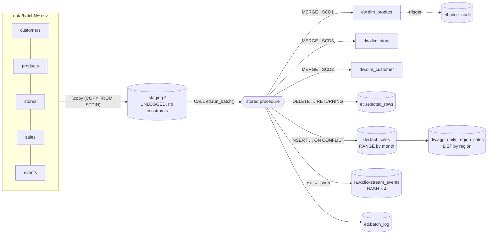
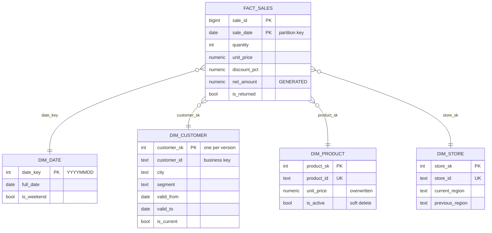

# DE SQL Pipeline — GrokMart Retail Warehouse


An end-to-end, **batch ELT pipeline written in PostgreSQL**. CSV files are bulk-loaded with
`COPY`, cleaned and quarantined in staging, `MERGE`d into slowly changing dimensions, and
upserted into a **range-partitioned** fact table. A stored procedure orchestrates the batch,
triggers enforce warehouse rules, and every optimization claim is backed by a real
`EXPLAIN ANALYZE` plan.

> **Mini project brief:** *DE SQL Pipeline: MERGE on dimension + partitioned table + COPY load + EXPLAIN*

---

## Contents

- [Quick start](#quick-start)
- [Architecture](#architecture)
- [Project structure](#project-structure)
- [The star schema](#the-star-schema)
- [What happens in a batch](#what-happens-in-a-batch)
- [Topic map: where each concept lives](#topic-map-where-each-concept-lives)
- [SCD Type 1 / 2 / 3](#scd-type-1--2--3)
- [Partitioning: range, list, hash](#partitioning-range-list-hash)
- [Indexes and EXPLAIN ANALYZE](#indexes-and-explain-analyze)
- [ACID and isolation levels](#acid-and-isolation-levels)
- [Data-quality tests](#data-quality-tests)
- [Design decisions](#design-decisions)

---

## Quick start

**Requirements:** PostgreSQL **15+** (`MERGE`) — 16 recommended (`pg_input_is_valid`) — and `psql`.
Python is only needed to regenerate data or run the isolation demo.

```bash
git clone https://github.com/mohdibrahim77/week5-de-sql-pipeline.git
cd week5-de-sql-pipeline

# Option A: local PostgreSQL (uses PGHOST/PGPORT/PGUSER/PGPASSWORD)
createdb grokmart
psql -d grokmart -f pipeline/run_all.sql          # run from the repo root

# Option B: Docker
docker compose up -d
docker compose exec -w /workspace db psql -U postgres -d grokmart -f pipeline/run_all.sql
```

Expected tail of the output:

```text
NOTICE:  batch batch1 OK | staged 30002 | rejected 2  | facts +30000 ~0  | dims P60 S12 C400 | events +8000
NOTICE:  batch batch2 OK | staged 15062 | rejected 13 | facts +15000 ~50 | dims P15 S3 C110 | events +4000
NOTICE:  PASS  scd2: exactly one current version per customer
...
NOTICE:  PASS  trigger: expired SCD2 versions are immutable
```

Then explore:

```bash
psql -d grokmart -f analysis/01_dml_cookbook.sql        # INSERT/UPDATE/DELETE/MERGE/UPSERT (rolled back)
psql -d grokmart -f analysis/02_explain_analyze.sql     # plans: pruning, composite/partial/GIN indexes
psql -d grokmart -f analysis/03_transactions_acid.sql   # atomicity, savepoints, deferred constraints
psql -d grokmart -f analysis/04_json_queries.sql        # JSONB operators, jsonb_to_recordset, JSON path
psql -d grokmart -f analysis/05_star_schema_reports.sql # business reports off the star
psql -d grokmart -f analysis/06_scd_inspection.sql      # SCD 1/2/3 side by side

pip install psycopg2-binary
python scripts/isolation_demo.py "dbname=grokmart user=postgres host=localhost"
```

---

## Architecture



| Schema | Purpose |
|---|---|
| `staging` | Landing zone for `COPY`. Unlogged and constraint-free, so bad rows land here and can be inspected. Truncated after each successful batch. |
| `dw` | Star schema: dimensions, the partitioned fact table, and the regional mart. |
| `raw` | Semi-structured clickstream kept as `jsonb`. |
| `etl` | Pipeline metadata: batch log, quarantine, price audit, and all ETL functions and procedures. |

---

## Project structure

```text
week5-de-sql-pipeline/
├── sql/                          # warehouse definition + ETL code (run in order)
│   ├── 00_init.sql               # schemas, batch_log, rejected_rows, price_audit
│   ├── 01_dimensions.sql         # dim_date, dim_product (SCD1), dim_customer (SCD2), dim_store (SCD3)
│   ├── 02_partitioning.sql       # fact_sales RANGE · agg LIST · clickstream HASH · auto-partition fn
│   ├── 03_staging.sql            # UNLOGGED landing tables
│   ├── 04_triggers.sql           # updated_at, price audit, SCD2 history guard
│   ├── 05_merge_dimensions.sql   # MERGE functions for SCD 1 / 2 / 3
│   ├── 06_load_facts.sql         # validation/quarantine, fact UPSERT, JSON events, mart refresh
│   ├── 07_run_batch.sql          # etl.run_batch() — orchestrating stored procedure
│   └── 08_post_load_indexes.sql  # composite, covering, partial, GIN, expression indexes
├── pipeline/
│   ├── run_all.sql               # one command: DDL → batch1 → indexes → batch2 → tests
│   ├── load_batch1.sql           # \copy batch1 CSVs + CALL etl.run_batch('batch1')
│   └── load_batch2.sql           # \copy batch2 CSVs + CALL etl.run_batch('batch2')
├── analysis/                     # learning / demo scripts (read-only or rolled back)
│   ├── 01_dml_cookbook.sql
│   ├── 02_explain_analyze.sql
│   ├── 03_transactions_acid.sql
│   ├── 04_json_queries.sql
│   ├── 05_star_schema_reports.sql
│   └── 06_scd_inspection.sql
├── tests/validate.sql            # 14 data-quality assertions
├── data/batch1, data/batch2      # generated CSVs (~6 MB)
├── scripts/
│   ├── generate_data.py          # deterministic generator (seed 42, stdlib only)
│   ├── isolation_demo.py         # 2-connection isolation level demo
│   ├── run_pipeline.sh / .ps1    # convenience runners
├── docs/
│   ├── explain_plans.md          # captured EXPLAIN ANALYZE output with commentary
│   └── test_prep.md              # predict-output, DML scenario, optimization Q&A
└── docker-compose.yml            # postgres:16 with the repo mounted
```

---

## The star schema



**Grain:** one row per sale line. The dataset holds 45,000 sales over Jan–Jun 2026, 430 customers, 65 products, 13 stores and 12,000 clickstream events.

---

## What happens in a batch

`CALL etl.run_batch('batch2')` runs these steps **in a single transaction**:

| # | Step | Technique |
|---|---|---|
| 0 | Refuse the batch if it already succeeded; allow a retry if it `FAILED` | `INSERT … ON CONFLICT DO UPDATE … WHERE status='FAILED'` |
| 1 | Product changes and new products | `MERGE`, SCD Type 1 (overwrite), with a trigger auditing price changes |
| 2 | Store region re-alignment | `MERGE`, SCD Type 3 (`previous_region`) |
| 3 | Customer moves and segment changes | Single-statement `MERGE` for SCD Type 2 (see below) |
| 4 | Remove bad sales rows | `WITH moved AS (DELETE … RETURNING) INSERT INTO etl.rejected_rows` |
| 5 | Create missing monthly partitions | `etl.ensure_month_partition()` with dynamic SQL |
| 6 | Load facts, including late corrections | `INSERT … ON CONFLICT (sale_id, sale_date) DO UPDATE … WHERE IS DISTINCT FROM` |
| 7 | Load events, skipping replays and malformed JSON | `pg_input_is_valid(payload,'jsonb')`, `ON CONFLICT DO NOTHING` |
| 8 | Refresh the regional mart | `TRUNCATE` + `INSERT … SELECT` into the LIST-partitioned table |
| 9 | Update statistics, clear staging, log row counts | `ANALYZE`, `TRUNCATE`, `UPDATE etl.batch_log` |

**Failure handling.** All the work runs inside a `BEGIN … EXCEPTION` block. If any step fails, every change is rolled back (atomicity). The procedure then marks the batch `FAILED`, `COMMIT`s that marker (procedures can do this, functions cannot) and re-raises the error, so the caller fails too. During development, PostgreSQL rejected a `RETURNING xmax` on the partitioned table. The batch rolled back cleanly and recorded the error, which shows this path works.

### `batch2` contains realistic edge cases

| Edge case in the data | Pipeline behavior |
|---|---|
| 30 customers moved city, 10 changed segment | 40 new SCD2 versions; the old ones are expired on 2026-04-30 |
| A stale duplicate customer row (older timestamp) | Dropped by `DISTINCT ON (customer_id) ORDER BY updated_at DESC` |
| 5 unchanged customers re-sent | No-op: the MERGE condition skips them |
| 8 price changes, 2 discontinued products, 5 new | Overwritten / `is_active=false` / inserted. Price audit gets 8 rows |
| 2 stores re-assigned to another region | `previous_region` is filled |
| 50 April sales re-sent with a new quantity | **Upserted**: `facts_updated = 50`, `updated_batch = 'batch2'` |
| 12 bad sales rows (qty ≤ 0, unknown product, NULL customer) | Quarantined with a reason |
| 200 replayed events and 1 truncated JSON payload | Replays ignored; bad JSON quarantined |
| Sales in May and June | Partitions `fact_sales_2026_05` and `_06` are created automatically |

---

## Topic map: where each concept lives

| Week 5 topic | Where |
|---|---|
| **INSERT** | multi-row, `INSERT … SELECT`, `RETURNING`: `analysis/01`; fact load: `sql/06` |
| **UPDATE** | `UPDATE … FROM`, `CASE`: `analysis/01`; SCD2 expiry: `sql/05` |
| **DELETE** | `DELETE … USING`, `DELETE … RETURNING` used to move rows to quarantine: `sql/06`, `analysis/01` |
| **MERGE** | SCD 1/2/3 dimensions: `sql/05`; update + delete + insert in one statement: `analysis/01` |
| **UPSERT** | `ON CONFLICT DO UPDATE / DO NOTHING`: `sql/06`, `sql/07`, `analysis/01` |
| **RANGE partitioning** | `dw.fact_sales` by month, plus auto-creation: `sql/02` |
| **LIST partitioning** | `dw.agg_daily_region_sales` by region: `sql/02` |
| **HASH partitioning** | `raw.clickstream_events` by customer: `sql/02` |
| **COPY** | `\copy … WITH (FORMAT csv, HEADER true)`: `pipeline/load_batch*.sql` |
| **EXPLAIN ANALYZE** | `analysis/02`, with captured output in [`docs/explain_plans.md`](docs/explain_plans.md) |
| **Composite index** | `(customer_sk, sale_date)`, `(product_sk, sale_date) INCLUDE (…)`: `sql/08` |
| **Partial index** | `WHERE is_returned`, `WHERE is_current`: `sql/08` |
| **ACID** | `analysis/03`; atomic batch: `sql/07` |
| **Isolation levels** | `analysis/03` and `scripts/isolation_demo.py` |
| **Stored procedures** | `etl.run_batch` (with transaction control): `sql/07` |
| **Triggers** | updated_at, price audit, SCD2 immutability: `sql/04` |
| **Star schema** | `sql/01`, `sql/02`; reports: `analysis/05` |
| **SCD Type 1/2/3** | `sql/05`; inspection: `analysis/06` |
| **JSON queries** | `->`, `->>`, `#>>`, `@>`, `?`, `jsonb_to_recordset`, JSON path, `jsonb_build_object`: `analysis/04` |

---

## SCD Type 1 / 2 / 3

| Type | Table | On change | History | Typical use |
|---|---|---|---|---|
| **1** | `dim_product` | Overwrite in place | None in the dimension; the price trigger keeps an audit trail | Corrections, attributes nobody reports historically |
| **2** | `dim_customer` | Expire the current row and insert a new version | Full history, with point-in-time joins | Anything that changes how past facts should be grouped (city, segment) |
| **3** | `dim_store` | Shift current → previous, then set the new value | One previous value | Re-organizations: "report under the old and the new structure" |

### SCD2 in a single `MERGE`

A `MERGE` source row can either update or insert, not both, yet a changed customer needs both.
The solution is to feed each changed customer into the merge **twice**:

```sql
USING (
    SELECT customer_id AS merge_key, * FROM src        -- matches current row → UPDATE (expire)
    UNION ALL
    SELECT NULL        AS merge_key, * FROM changed    -- never matches      → INSERT (new version)
) s
ON t.customer_id = s.merge_key AND t.is_current
WHEN MATCHED AND (t.city, t.segment, …) IS DISTINCT FROM (s.city, s.segment, …) THEN
    UPDATE SET valid_to = s.effective_date - 1, is_current = false
WHEN NOT MATCHED THEN
    INSERT (…) VALUES (…, s.effective_date, '9999-12-31', true, …)
```

"One current version per customer" is enforced by
`EXCLUDE USING btree (customer_id WITH =) WHERE (is_current) DEFERRABLE INITIALLY DEFERRED`.
This works like a partial unique index, but it **can be deferred**. That matters because the planner may insert the new version before it expires the old one within the same statement.

The fact load joins `sale_date BETWEEN valid_from AND valid_to`, so a May sale gets the May version of the customer. [`analysis/06`](analysis/06_scd_inspection.sql) shows revenue split by "city at time of sale" versus "current city".

---

## Partitioning: range, list, hash

| Table | Strategy | Why |
|---|---|---|
| `dw.fact_sales` | `RANGE (sale_date)`, monthly, plus a `DEFAULT` partition | Time-series queries prune to a few months, and old months can be detached or archived cheaply |
| `dw.agg_daily_region_sales` | `LIST (region)` | Each regional team reads only its own partition |
| `raw.clickstream_events` | `HASH (customer_id)`, modulus 4 | No natural range; spreads writes and `VACUUM` work evenly |

Gotchas this project handles:

- A primary key on a partitioned table must contain the partition key, so the PK is `(sale_id, sale_date)`.
- New months need a partition. `etl.ensure_month_partition()` creates it on demand, and the `DEFAULT` partition (tested to be empty) catches anything unexpected.
- System columns such as `xmax` cannot be returned from a partitioned table, so inserts and updates are counted with `updated_batch IS NULL` instead.

---

## Indexes and EXPLAIN ANALYZE

Highlights from [`docs/explain_plans.md`](docs/explain_plans.md), captured on real data:

| Experiment | Result |
|---|---|
| `WHERE sale_date >= '2026-03-01' AND < '2026-04-01'` | **1 of 7 partitions** scanned |
| `WHERE date_trunc('month', sale_date) = …` | **All 7** scanned: wrapping the key in a function breaks pruning |
| Customer and date-range lookup, without vs. with the composite index | **290 → 53 buffers**, ~5× faster |
| Returns-desk query using the partial index `WHERE is_returned` | Small index (~3% of rows) is used; the same query without `is_returned` cannot use it |
| Covering index `INCLUDE (quantity, net_amount)` | **Index Only Scan, Heap Fetches: 0** |
| JSONB `@>` with a GIN `jsonb_path_ops` index | Bitmap Index Scan when the filter is selective; Seq Scan when it isn't (cost-based choice) |

Index experiments use `BEGIN; DROP INDEX …; EXPLAIN …; ROLLBACK;`. DDL is transactional in PostgreSQL, so the index returns after the rollback.

---

## ACID and isolation levels

`python scripts/isolation_demo.py` opens two real connections and shows:

| Scenario | Level | Outcome |
|---|---|---|
| Non-repeatable read | READ COMMITTED | T1 reads the price twice and gets two different values |
| Stable snapshot | REPEATABLE READ | T1 sees the old value; its own update fails with `40001` (retry) |
| Lost update | READ COMMITTED | Two read-modify-write transactions; one change disappears |
| Write skew | SERIALIZABLE | The second commit is aborted with `40001` |

`analysis/03_transactions_acid.sql` covers the rest: an aborted transaction undoes every statement, `SAVEPOINT` allows a partial rollback, a deferred constraint fails at `COMMIT`, and `UNLOGGED` tables give up durability for speed.

---

## Data-quality tests

`tests/validate.sql` runs automatically at the end of `run_all.sql`. Each check raises an error if it fails.

- SCD2: exactly one current version per customer; contiguous ranges with no gaps or overlaps; 40 customers with 2 versions
- SCD1: product count, soft deletes, price-audit rows written by the trigger
- SCD3: 2 stores carry a `previous_region`
- Fact row count matches the batch log; 50 corrections upserted; 14 sales rows quarantined
- 6 monthly partitions exist and the `DEFAULT` partition is empty
- Every fact joins the customer version that was valid on its sale date
- The LIST-partitioned mart reconciles to the fact table to the paisa
- 12,000 unique events, replays ignored, 1 malformed JSON quarantined
- Re-running a successful batch is refused (idempotency)
- Modifying an expired SCD2 version is blocked by the trigger

---

## Design decisions

- **Logic lives in the database.** Every transformation is SQL or PL/pgSQL, so the pipeline can be scheduled by cron, Airflow (`PostgresOperator`) or anything else that can call `CALL etl.run_batch(...)`.
- **Client-side `\copy` instead of server-side `COPY`.** It needs no superuser rights or server file access and works the same locally and in Docker. The server-side syntax is shown in comments.
- **Indexes are built after the first bulk load.** Building an index once is cheaper than maintaining it for 30,000 inserts.
- **`IS DISTINCT FROM` everywhere.** It is NULL-safe change detection, and it means unchanged rows are never rewritten: no wasted WAL, no table bloat, no spurious trigger firings.
- **Deterministic data.** `python scripts/generate_data.py` regenerates byte-identical CSVs (seed 42), so test expectations are exact numbers.

---

*Data Grokr — Week 5 mini project.*
